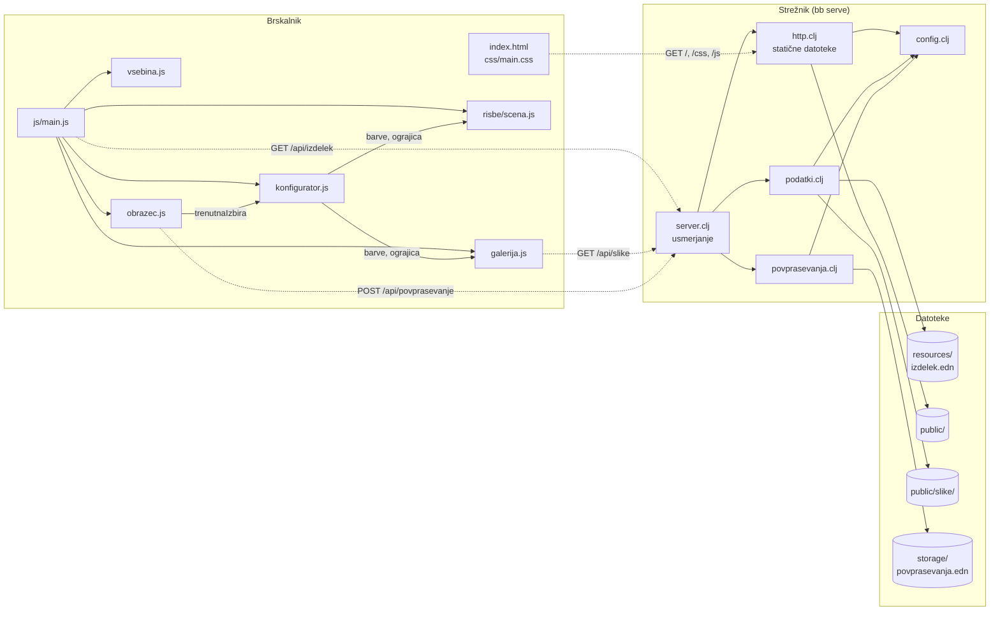
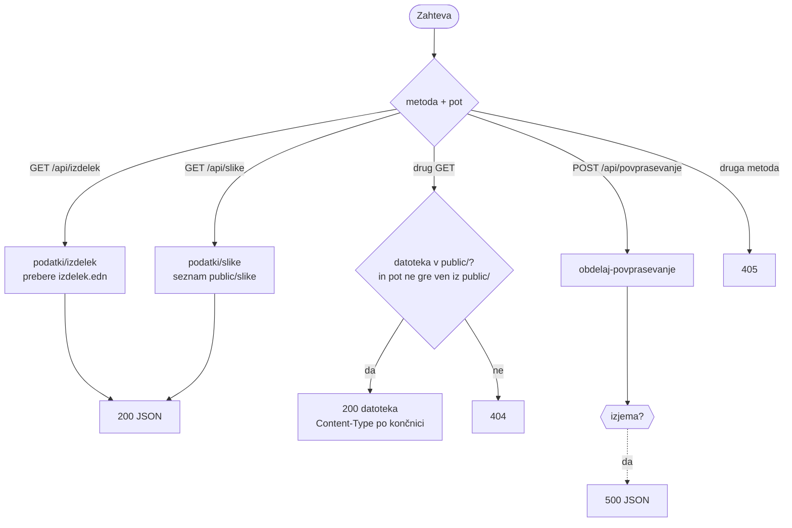
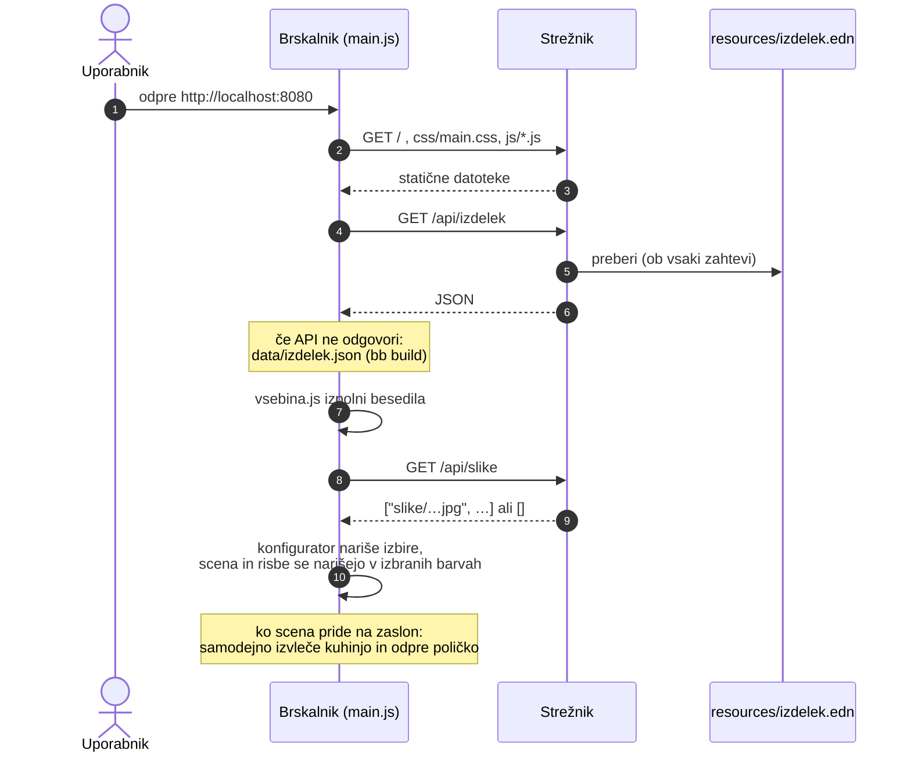
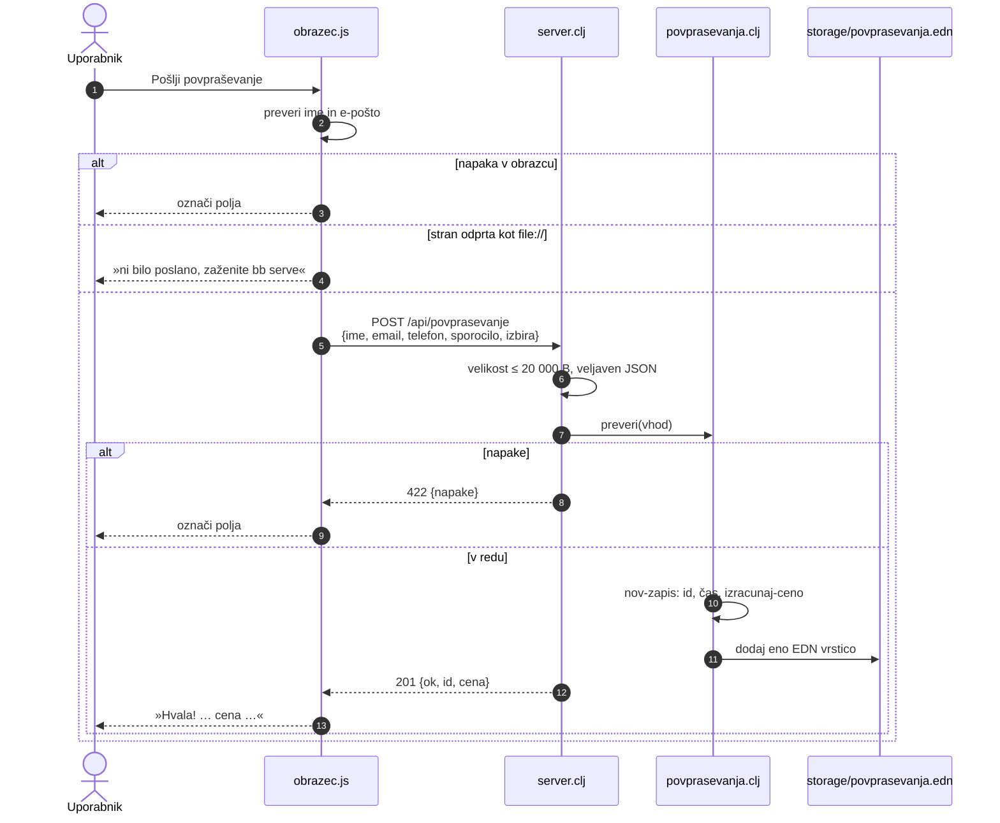
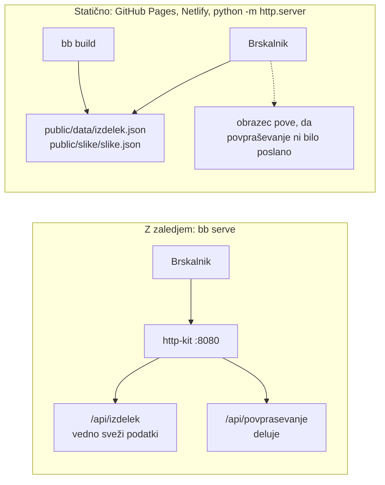
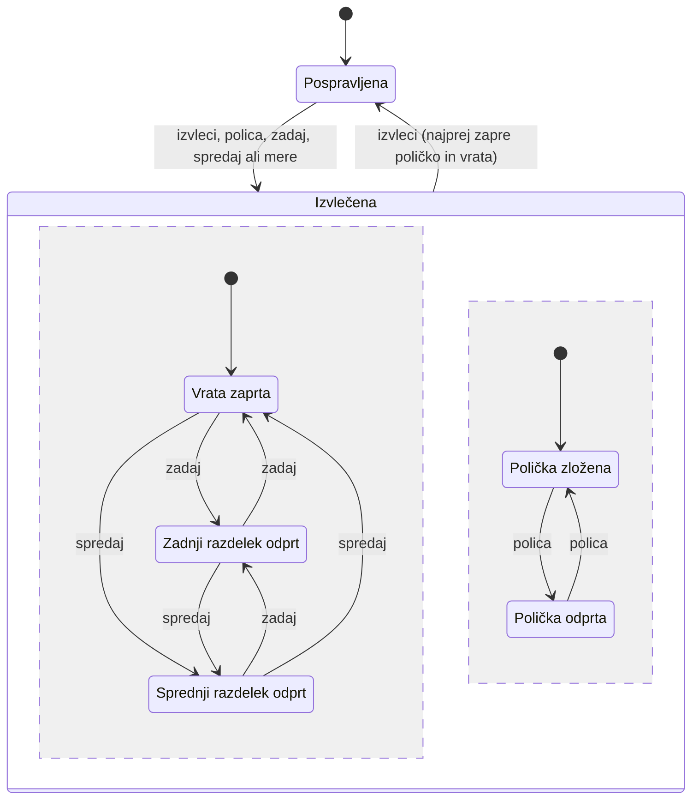

# Arhitektura

Stran ima dva dela, ki si delita en vir podatkov:

- **Zaledje v Clojure** (Babashka, http-kit) streže datoteke, podatke o izdelku in sprejema povpraševanja.
- **Spletni del v čistem JS** nariše vse v brskalniku: besedila, interaktivni prikaz, konfigurator in obrazec.

Vsa vsebina (besedila, mere, izvedbe, cene) je v **`resources/izdelek.edn`**. Nikjer drugje ni podvojena.

## Komponente

## Usmerjanje zahtev

`kuhinja.server/app` je en Ring obdelovalec. Najprej preveri API poti, nato poskusi statično datoteko.

## Tok: nalaganje strani

## Tok: povpraševanje

Brskalnik pošlje samo **izbiro** (id-je). Cene, ki jo vidi uporabnik, strežnik ne prevzame, ampak jo izračuna znova iz `izdelek.edn`.

## Načina delovanja

## Stanja interaktivnega prikaza

`risbe/scena.js` ima ciljno in trenutno stanje (vse vrednosti 0..1). Animacija trenutno vrednost vsak okvir približa cilju. Pravila:

- polička, razdelek ali mere najprej izvlečejo kuhinjo,
- na isti strani je lahko odprt samo en razdelek (vrata tečejo drugo čez drugo),
- kuhinja gre nazaj šele, ko so polička in vrata zaprta.

## Odločitve

| Odločitev | Zakaj |
|---|---|
| Babashka namesto JVM Clojure | en program brez Jave, zagon v ~20 ms, http-kit in cheshire sta že vgrajena |
| En vir podatkov (`izdelek.edn`) | besedila in cene se spremenijo na enem mestu; `bb build` jih izvozi za statično gostovanje |
| Cena na strežniku | brskalniku se ne zaupa; cena v brskalniku je samo za prikaz |
| Povpraševanja v EDN datoteki | za testno stran dovolj, brez baze; ena vrstica na zapis, preprosto branje z `clojure.edn` |
| Čisti JS z ES moduli | brez odvisnosti in brez koraka gradnje, a vseeno ločeno po odgovornostih |
| SVG iz kode | risbe so v pravih merah modela v7 in se prebarvajo po izbiri |
| `-Djava.net.preferIPv4Stack=true` | sicer WSL strežnika ne posreduje v Windows (glej [razvoj.md](razvoj.md#wsl-in-windows)) |
| Strežnik posluša samo na 127.0.0.1 | dostopen samo z lastnega računalnika; `HOST=0.0.0.0` ga odpre omrežju |
