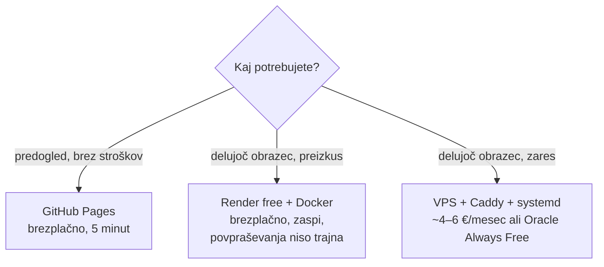

# Namestitev in objava

Stran lahko teče na dva načina:

| Način | Kaj dela | Obrazec | Kje |
|---|---|---|---|
| **Statično** | `bb build` in mapa `public/` | ne pošilja (pove, da je predogled) | GitHub Pages, Cloudflare Pages, Netlify |
| **S strežnikom** | `bb serve` | deluje, shranjuje v `storage/` | Render, VPS, Docker kjer koli |



---

## 1. Lokalno (razvoj)

```bash
mkdir -p ~/.local/bin
curl -sL https://raw.githubusercontent.com/babashka/babashka/master/install | bash -s -- --dir ~/.local/bin
git clone https://github.com/andrazzz/spletnaStranCaliCLI.git
cd spletnaStranCaliCLI
bb serve                      # http://localhost:8080
```

V WSL glej [razvoj.md › WSL in Windows](razvoj.md#wsl-in-windows).

---

## 2. GitHub Pages (statični predogled, brezplačno)

Objavo opravi `.github/workflows/pages.yml` ob vsakem pushu na `main`.

**Enkratna nastavitev:**

1. Na GitHubu odprite repozitorij → **Settings** → **Pages**.
2. Pri **Build and deployment → Source** izberite **GitHub Actions**.
3. **Actions** → **GitHub Pages** → **Run workflow** (ali pa samo pushajte na `main`).
4. Po ~1 minuti je stran na `https://andrazzz.github.io/spletnaStranCaliCLI/`. Povezava je tudi v Settings → Pages in pri zadnjem zagonu posla.

**Kako deluje:** posel namesti Babashko, požene `bb build` (ustvari `public/data/izdelek.json` in `public/slike/slike.json`) in objavi mapo `public/`. Stran poskusi `/api/izdelek`, ki na Pages ne obstaja, zato prebere `data/izdelek.json`. Obrazec ugotovi, da strežnika ni, in sporoči, da gre za predogled.

**Omejitve:** brezplačno za javne repozitorije, samo statične datoteke, brez obdelave obrazca. Stran je javna.

---

## 3. Render (strežnik v Dockerju, brezplačni paket)

Repozitorij ima `Dockerfile` in `render.yaml`.

1. Ustvarite račun na [render.com](https://render.com) in povežite GitHub.
2. **New → Blueprint**, izberite repozitorij. Render prebere `render.yaml` in zgradi sliko.
3. Stran je na `https://kuhinja-cali.onrender.com` (ali podobno).

**Omejitve brezplačnega paketa** (stanje november 2026, preverite na [render.com/docs/free](https://render.com/docs/free)):

- po 15 minutah brez obiska zaspi, prvi naslednji obisk traja do ~1 minute,
- datotečni sistem ni trajen: `storage/povprasevanja.edn` se ob ponovnem zagonu ali uspavanju izgubi. Vsako povpraševanje je zapisano tudi v dnevniku (**Logs**: »Novo povpraševanje: …«),
- trajni disk je samo pri plačljivih paketih.

Za preizkus delujočega obrazca je to dovolj, za prave stranke ne.

---

## 4. Docker (kjer koli)

```bash
docker build -t kuhinja-cali .
docker run -d --name kuhinja -p 8080:8080 -v kuhinja-storage:/app/storage kuhinja-cali
```

- `-v kuhinja-storage:/app/storage` ohrani povpraševanja med ponovnimi zagoni.
- Fotografije: `-v "$PWD/public/slike:/app/public/slike"`.
- Sliko ob vsakem pushu zgradi in preizkusi CI (posel `docker`).

---

## 5. VPS (trajno, s HTTPS)

Za strežnik Linux (Debian/Ubuntu): Hetzner, Netcup, DigitalOcean ali brezplačni Oracle Cloud Always Free.

**Potrebujete:** VPS z javnim IP, domeno (ali poddomeno) z zapisom A na IP strežnika in SSH dostop.

```bash
# na strežniku
sudo apt update && sudo apt install -y git curl caddy
curl -sL https://raw.githubusercontent.com/babashka/babashka/master/install | sudo bash

sudo useradd --system --home /opt/kuhinja-cali --shell /usr/sbin/nologin kuhinja
sudo git clone https://github.com/andrazzz/spletnaStranCaliCLI.git /opt/kuhinja-cali
sudo chown -R kuhinja:kuhinja /opt/kuhinja-cali/storage /opt/kuhinja-cali/public/data /opt/kuhinja-cali/public/slike

# storitev
sudo cp /opt/kuhinja-cali/deploy/kuhinja-cali.service /etc/systemd/system/
sudo systemctl daemon-reload
sudo systemctl enable --now kuhinja-cali
systemctl status kuhinja-cali          # mora biti »active (running)«

# HTTPS: v deploy/Caddyfile zamenjajte kuhinja.example.si s svojo domeno
sudo cp /opt/kuhinja-cali/deploy/Caddyfile /etc/caddy/Caddyfile
sudo systemctl reload caddy
```

Požarni zid: odprta naj bosta samo 22 (SSH), 80 in 443. Vrata 8080 ostanejo zaprta, ker strežnik posluša samo na `127.0.0.1`.

**Posodobitev:**

```bash
cd /opt/kuhinja-cali && sudo git pull && sudo systemctl restart kuhinja-cali
```

**Varnostna kopija povpraševanj:** `/opt/kuhinja-cali/storage/povprasevanja.edn` (na primer s cron in `rsync` na drug računalnik).

**Dnevnik:** `journalctl -u kuhinja-cali -f`

---

## Brezplačna gostovanja na kratko

Stanje november 2026. Pogoji se pogosto spreminjajo, zato jih pred odločitvijo preverite.

| Gostovanje | Za ta projekt | Opomba |
|---|---|---|
| GitHub Pages | statični predogled | brezplačno za javne repozitorije, že nastavljeno |
| Cloudflare Pages, Netlify | statični predogled | podobno kot Pages; mapa `public/`, ukaz `bb build` |
| Render (free) | strežnik, preizkus | zaspi po 15 min, brez trajnega diska |
| Oracle Cloud Always Free | pravi VPS, trajno | brezplačen ARM VM (letos zmanjšan na 2 OCPU / 12 GB); pogosto ni prostih zmogljivosti, nedejavne instance lahko odvzame |
| Koyeb | strežnik | brezplačni paket se je v letu 2026 spremenil; preverite pred uporabo |
| Plačljiv VPS (Hetzner ipd.) | trajno, zanesljivo | ~4–6 €/mesec, priporočeno za pravo uporabo |
