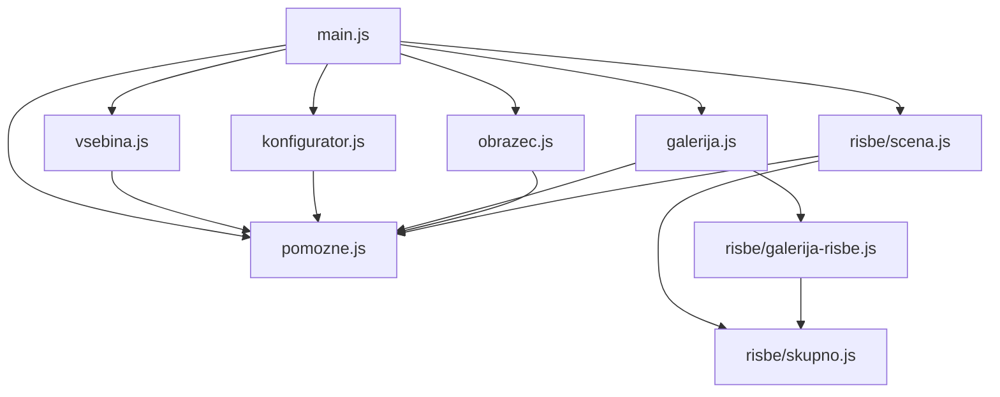

# Spletni del

Čisti HTML, CSS in JavaScript. `index.html` naloži en modul (`js/main.js`), ta pa uvozi ostale. Ker so ES moduli, brskalnik strani ne naloži kot `file://`: potreben je strežnik (`bb serve` ali kateri koli statični).

## Moduli



| Modul | Odgovornost | Izvozi |
|---|---|---|
| `main.js` | naloži podatke, poveže module, obdela `?prikaz=` | (nič) |
| `pomozne.js` | `$`, `$$`, `esc`, `evri`, `preznak`, `naloziJson`, `naStrezniku`, `manjGibanja` | vse naštete |
| `vsebina.js` | besedila, ploščice, lastnosti, kartice razdelkov, tabela | `izpolniVsebino` |
| `konfigurator.js` | izbire, cena, povzetek | `postaviKonfigurator`, `trenutnaIzbira` |
| `galerija.js` | fotografije ali risbe, povečava | `postaviGalerijo`, `osveziRisbe`, `postaviPovecavo` |
| `obrazec.js` | preverjanje in pošiljanje povpraševanja | `postaviObrazec` |
| `risbe/scena.js` | interaktivni prikaz, stanje, animacija | `postaviSceno`, `nastaviCilj`, `nastaviTakoj`, `samodejniPrikaz`, `obSpremembiStanja`, `osveziKrmilo` |
| `risbe/galerija-risbe.js` | čelni pogled in tloris kot `data:` URL | `risbaCelo`, `risbaTloris` |
| `risbe/skupno.js` | barve lesa, SVG gradniki, vzorec karbona | `LES`, `KOT_PALICE`, `pr`, `polnilo`, `definicije` |

Moduli se med seboj ne kličejo neposredno, razen prek `main.js`. Konfigurator na primer ne pozna scene, ampak pokliče povratno funkcijo, ki mu jo da `main.js`.

## Koordinate risb

Vse mere so v **centimetrih**, kot v modelu v7.

**Prikaz od strani (`scena.js`)**

- Lokalno za kuhinjo: `x` je dolžina (0 = zadnja stena, 84 = čelo), `z` je višina od dna kuhinje.
- Skupina kuhinje ima `transform="translate(0 59.5) scale(1 -1)"`, zato `z` raste navzgor. Tla avta so pri `y = 60`, kuhinja je 0,5 cm višje.
- Besedila (oznake, kote) so v nezrcaljeni skupini, sicer bi bila obrnjena.
- `viewBox="-52 -14 222 80"`: levo je prostor za Bluetti, desno za izvlečeno kuhinjo z odprto poličko.

| Element | Premik |
|---|---|
| `#kuhinja-premik` | `translate(50·izvlek)` |
| `#vodilo-srednje` | pol izvleka (teleskopsko vodilo) |
| `#vrata-zadaj` / `#vrata-spredaj` | ±41,6 cm |
| `#polica` | `rotate(90·polica, 84, 44)` okrog tečaja na vrhu čela |
| `#palica` | vidna nad 85 % odprtosti, pod kotom 52° |

## Prikaz prek povezave

`?prikaz=` takoj (brez animacije) nastavi stanje. Vrednosti ločite z vejico: `izvleci`, `polica`, `zadaj`, `spredaj`, `mere`.

```
http://localhost:8080/?prikaz=polica,mere
http://localhost:8080/?prikaz=spredaj
```

## Dostopnost

- Gumbi prikaza imajo `aria-pressed`, kartice razdelkov se odprejo tudi s tipkama Enter in presledek.
- `prefers-reduced-motion`: brez animacij in brez samodejnega prikaza.
- Stanje obrazca je v `role="status" aria-live="polite"`.
- Barve imajo temno različico (`prefers-color-scheme: dark`).

## CSS

En sam `css/main.css`, razdeljen s komentarji po razdelkih strani. Barve in pisave so spremenljivke na `:root`. Razdelek z naročilom ima svoje vrednosti spremenljivk (temno ozadje), povzetek pa spet svetle.
